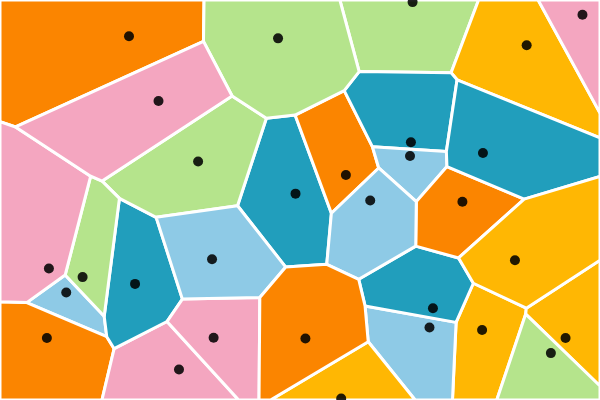
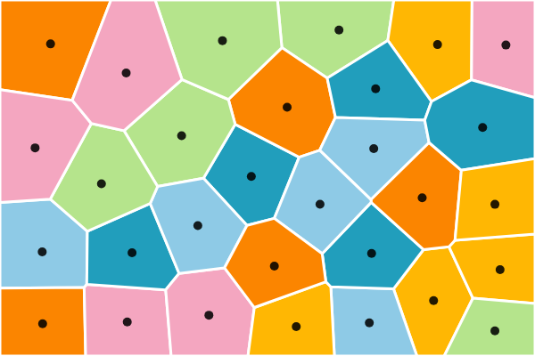

# voronoi_flutter

Simple Voronoi diagrams for Flutter. Give it points, get cells. Includes a widget to draw them.

Started as a master's project, now updated for current Flutter and Dart.

| 30 random points | after 5 `relax()` steps |
| --- | --- |
|  |  |

Made with `flutter test tool/screenshots.dart`.

## Install

```yaml
dependencies:
  voronoi_flutter:
    git:
      url: https://github.com/YaminT/voronoi_flutter
```

## Use

### Draw a diagram

Sites use unit coordinates (0 to 1), so the diagram scales with the widget.

```dart
VoronoiView(
  sites: const [Offset(0.2, 0.3), Offset(0.7, 0.4), Offset(0.5, 0.8)],
  onCellTap: (cell) => print('tapped ${cell.index}'),
)
```

### Compute a diagram

```dart
final voronoi = Voronoi(points, const Rect.fromLTWH(0, 0, 400, 300));

for (final cell in voronoi.cells) {
  cell.site;       // the input point
  cell.polygon;    // corners of the cell
  cell.neighbors;  // indices of touching cells
  cell.area;
  cell.centroid;
  cell.toPath();   // a Path for drawing
}

voronoi.cellAt(Offset(120, 80)); // cell that contains a point
voronoi.relax();                 // Lloyd relaxation, returns a new diagram
Voronoi.random(100, bounds);     // random sites, optional seed
```

### Draw without widgets (engine only)

The drawing code uses only `dart:ui`, so it also works straight on the Flutter engine, with no widget framework.

```dart
paintVoronoi(canvas, voronoi, style: const VoronoiStyle(borderWidth: 4));

final picture = voronoiToPicture(voronoi);      // Picture
final image = await voronoiToImage(voronoi);   // Image, e.g. to save a PNG
```

`example/lib/engine_main.dart` is a full app with no widgets: it uses `PlatformDispatcher`, `SceneBuilder` and raw pointer events.

```sh
cd example
flutter run -t lib/engine_main.dart
```

## Notes

- Cells are clipped to the rectangle you pass in.
- A site gets an empty cell (`cell.isEmpty`) if another site has the same position (the first one keeps it), or if it lies outside the rectangle and its region is cut away.
- Sites must be finite; the rectangle must not be empty. Otherwise `ArgumentError`.
- Each cell is cut by the bisector to nearby sites, found through a grid. 20,000 sites take about half a second on a desktop.
- The diagram is computed on the main isolate. For very large inputs, build it in `compute()`.

## Where it is useful

- **Nearest place:** which store, station or sensor is closest to a point (`cellAt`).
- **Maps and games:** regions, territories, procedural worlds.
- **Even spreading:** `relax()` gives evenly spaced points for scatter, particles, or label placement.
- **Neighbour graphs:** `neighbors` gives which regions touch, for routing or coloring.
- **Visuals:** stained-glass, low-poly and cell patterns in backgrounds.
- **Data views:** show the area of influence of each point in a data set.

## Example

```sh
cd example
flutter create .
flutter run
```

## Tests

```sh
flutter test
```

## License

MIT
